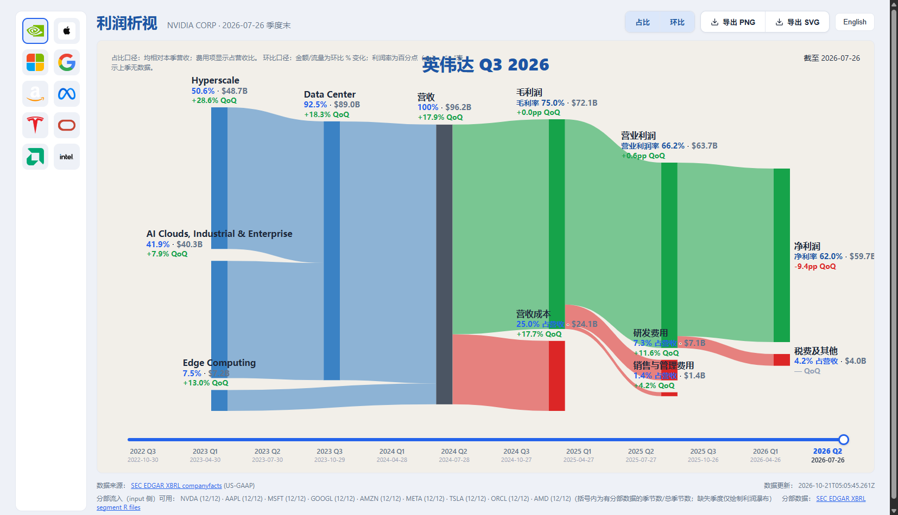

# 利润析视 Profit Bridge

> **10 秒看清一家巨头怎么赚钱：分部收入 → 利润桥 → 净利润，15 年商业史一图流。**
>
> **English**: See how a tech giant actually makes money — segment revenue flowing through a proportional Sankey "profit bridge" down to net income.

**[🌐 在线体验 → https://dao1023.github.io/profitbridge/](https://dao1023.github.io/profitbridge/)**　·　无需安装，点开即用



## 为什么值得一看

- 🌉 **利润桥桑基图** — 营收 → 毛利 → 营业利润 → 净利润，钱从哪来、被谁吃掉、剩多少，流宽即金额，一眼看穿。
- 📊 **全历史柱状图** — 任选科目/分部，2010 → 2026 逐季时间序列，**无断季、无空洞**。
- 🎚️ **占比 / 环比一键切换** — 看结构（占营收 %）或看动能（QoQ 变化），不用碰 Excel。
- 🏛️ **每个数字可溯源** — 全部来自 SEC EDGAR XBRL 真实申报，不是拍脑袋。
- 🫥 **缺数据就留白** — 不编数、不插值。没披露的季度诚实空着，这是工程诚信，不是缺陷。
- ⚡ **纯前端零构建** — 无框架、无 npm install，克隆或点开链接即可运行。

## 覆盖范围

**11 家巨头**：NVDA · AAPL · MSFT · GOOGL · AMZN · META · TSLA · ORCL · AMD · INTC · AVGO
利润表 **647 季**，分部收入 **293 季**（实测统计自 `data/profit.json` / `data/segments.json`）。

界面支持中英切换，图表可一键导出 SVG / PNG。

## 快速开始

1. **在线用**：直接打开 [https://dao1023.github.io/profitbridge/](https://dao1023.github.io/profitbridge/)；
2. **本地跑**：双击 `start.bat`（或 `node scripts/serve.mjs 8440`），浏览器打开 <http://127.0.0.1:8440/>；
3. **自托管**：本仓库是纯静态站点，GitHub Pages 选 `main / (root)` 即可，无任何构建步骤。

---

## 附录：数据口径与工程细节

<details>
<summary><b>数据来源与口径</b></summary>

- 来源：**SEC EDGAR XBRL companyfacts API**（利润表）+ **EDGAR 申报的分部 R 文件**（FilingSummary.xml → R\*.htm）。
- **Q4 由 FY − Q1..Q3 推导**（SEC 申报的是 YTD 累计值）。
- 只保留 **80–100 天** 的季度区间（真实季度长度连续性校验），并做利润链自洽校验（各桥节点可加合）。
- **缺失的科目/分部如实留空，不编造**：不申报毛利的公司（GOOGL/AMZN/META/ORCL）桑基自动切换结构；无分部披露的季度在数据 `notes` 中逐一列明；分部对不上营收的季度直接丢弃（`failures` 记录原因与原文出处）。
- **INTC**：Intel Foundry 模式下分部收入含内部销售，无干净的外部收入拆分 → 标记为 `degraded`，前端诚实降级展示。
- **TSM**：外国私人发行人，20-F 只有年度 ifrs-full 数据、无季度 US-GAAP XBRL → 不收录。
- **非经营性收益节点**：当净利润 > 营业利润时出现，数值 = 净利润 − 营业利润。GOOGL 2026 Q2 实例：NetIncomeLoss $112.19B、OperatingIncomeLoss $40.77B，桥内 71.42 自洽（已核对 10-Q frame CY2026Q2 原始 XBRL）。
- 数值单位：百万美元（$M）。

</details>

<details>
<summary><b>利润桥实现</b></summary>

- 手写 SVG 桑基图，单一公共比例尺（px/$），流宽误差 < 1%；
- hover tooltip 显示精确金额与占比/环比。

</details>

<details>
<summary><b>更新数据</b></summary>

```powershell
$env:NODE_USE_ENV_PROXY="1"; $env:HTTPS_PROXY="http://127.0.0.1:7897"   # 如需代理
node scripts/fetch_profit.mjs    # 利润表 → data/profit.json + data/profit.json.js
node scripts/fetch_segments.mjs  # 分部 → data/segments.json
node scripts/validate_profit.mjs # 口径校验
```

`data/profit.json.js` 是 `profit.json` 的 JSONP 内联副本（`window.__PROFIT_DATA`），仅供 file:// 双击打开时兜底；正常走 HTTP 时前端 `fetch` 同目录 JSON。

</details>

<details>
<summary><b>目录结构与脚本</b></summary>

```
index.html / app.js    站点（原生 JS + vendor/echarts.min.js 5.6）
data/                  profit.json / segments.json / companies.json / logos/
scripts/               serve.mjs（零依赖静态服务器）、fetch_profit.mjs、
                       fetch_segments.mjs、validate_profit.mjs、
                       verify_profit_fix.mjs、verify_segments_hist.mjs（回归）
tests/                 verify_bar / verify_modes / verify_timeline2（无头 CDP 回归，
                       需先起 :8440 服务；截图与浏览器 profile 落在 tests/.shots、tests/.chrome）
docs/screenshots/      README 配图
```

</details>

## License

数据来自 SEC EDGAR（公有领域）。代码 MIT。
