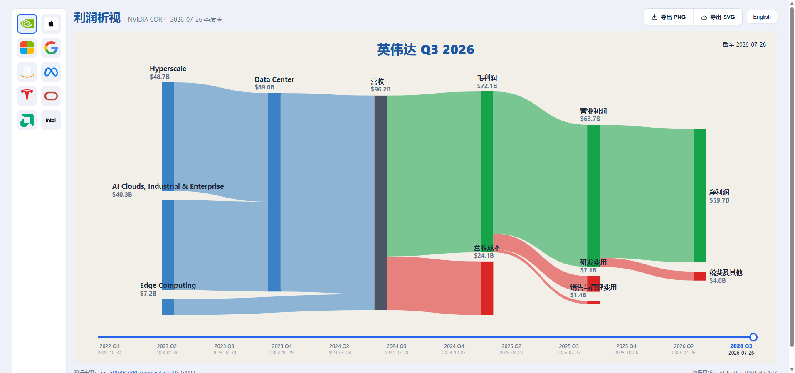
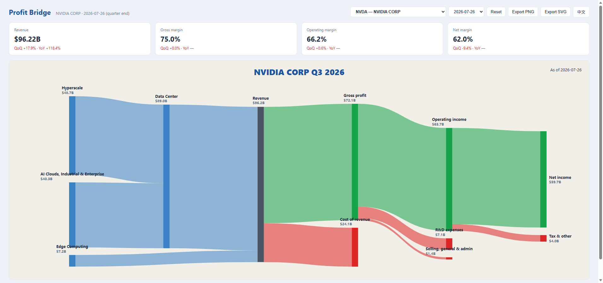

# 利润析视 Profit Bridge

> 一个纯静态的上市公司利润可视化看板：从**营收**到**净利润**的完整利润桥（桑基图），全部数字来自 SEC EDGAR XBRL 真实申报数据，流宽与金额严格成比例。无框架、无构建，克隆即用。

| 默认视图（NVDA） | 全历史分部（NVDA 最新季） | 占比 + 环比模式 |
| --- | --- | --- |
|  |  |  |

**English**: Profit Bridge is a zero-build, static-site dashboard that visualizes each company's income statement as a proportional Sankey "profit bridge" (revenue → cost/operating expenses → tax → net income), plus a full-history segment bar view. All figures come from SEC EDGAR XBRL filings. No framework, no build step — clone and serve.

## 功能

- **利润桥桑基图**：营收 → 毛利/成本 → 研发/销管等费用 → 营业利润 → 税费/非经营性项目 → 净利润；手写 SVG，单一公共比例尺（px/$），流宽误差 < 1%；hover tooltip 显示精确金额。
- **柱状图全历史视图**：任选分部 / 利润表科目，看 2010 年至今的完整季度时间序列；支持**占比模式**（各分部占营收比重）与**环比模式**（QoQ 变化）。
- **11 家公司全历史数据**：NVDA / AAPL / MSFT / GOOGL / AMZN / META / TSLA / ORCL / AMD / INTC / AVGO。利润表共 647 季（多数公司 64 季，2010 年至今），分部数据 293 季。
- **中英切换**：界面与图内标签全部支持。
- **导出**：SVG / PNG 一键下载。

## 数据与口径（诚实原则）

- 来源：**SEC EDGAR XBRL companyfacts API**（利润表）+ **EDGAR 申报的分部 R 文件**（FilingSummary.xml → R\*.htm，分部收入明细）。
- **Q4 由 FY − Q1..Q3 推导**（SEC 申报的是 YTD 累计值）。
- 只保留 **80–100 天** 的季度区间（真实季度长度连续性校验），并做利润链自洽校验（各桥节点可加合）。
- **缺失的科目/分部如实留空，不编造**：不申报毛利的公司（GOOGL/AMZN/META/ORCL）桑基自动切换结构；无分部披露的季度在数据 `notes` 中逐一列明；分部对不上营收的季度直接丢弃（`failures` 记录原因与原文出处）。
- **INTC**：Intel Foundry 模式下分部收入含内部销售，无干净的外部收入拆分 → 标记为 `degraded`，前端诚实降级展示。
- **TSM**：外国私人发行人，20-F 只有年度 ifrs-full 数据、无季度 US-GAAP XBRL → 不收录。
- **非经营性收益节点**：当净利润 > 营业利润时出现，数值 = 净利润 − 营业利润，即非经营性项目扣税后的净贡献。GOOGL 2026 Q2 实例：SEC 原文 NetIncomeLoss $112.19B、OperatingIncomeLoss $40.77B；桥内显示 71.42 = 112.19 − 40.77，自洽（已核对 10-Q frame CY2026Q2 原始 XBRL）。
- 数值单位：百万美元（$M）。

## 本地运行

- 双击 **`start.bat`**（起本地服务并打开 http://127.0.0.1:8440/）；
- 或 `node scripts/serve.mjs 8440`；
- 或直接双击 `index.html`（file:// 下自动回退到内联的 `data/profit.json.js`）。

零依赖、零构建：原生 JS + [echarts 5.6](https://echarts.apache.org/)（已内置于 `vendor/`）。

## 部署到 GitHub Pages

本仓库是**纯静态站点**，`index.html` 在仓库根、所有资源均为相对路径，无需任何构建：

1. 推送到 GitHub；
2. 仓库 **Settings → Pages → Source: Deploy from a branch → `main` / `(root)`**；
3. 完成，`https://<user>.github.io/<repo>/` 即为看板。

## 更新数据

```powershell
$env:NODE_USE_ENV_PROXY="1"; $env:HTTPS_PROXY="http://127.0.0.1:7897"   # 如需代理
node fetch_profit.mjs           # 利润表 → data/profit.json + data/profit.json.js
node scripts/fetch_segments.mjs # 分部 → data/segments.json
node scripts/validate_profit.mjs # 口径校验
```

## 数据管道（scripts/）

| 脚本 | 用途 |
| --- | --- |
| `serve.mjs` | 零依赖静态服务器（`node scripts/serve.mjs [port]`） |
| `fetch_segments.mjs` | 从 EDGAR 分部 R 文件抓取全历史分部收入 → `data/segments.json`（含对账丢弃与 notes） |
| `validate_profit.mjs` | 利润表口径校验（季度区间 80–100 天、利润链自洽） |
| `probe_profit.mjs` | 诊断 fetch_profit 丢季度问题（只读） |
| `probe_tsm.mjs` | 探查 TSM 的 ifrs-full 覆盖（只读，结论：无季度 XBRL，不收录） |
| `verify_segments_hist.mjs` / `verify_profit_fix.mjs` | 回归脚本：起无头浏览器截图对比验证前端行为 |

`data/profit.json.js` 是 `profit.json` 的 JSONP 内联副本（`window.__PROFIT_DATA`），仅供 file:// 双击打开时兜底；正常走 HTTP 时前端 `fetch` 同目录 JSON。

## License

数据来自 SEC EDGAR（公有领域）。代码 MIT。
